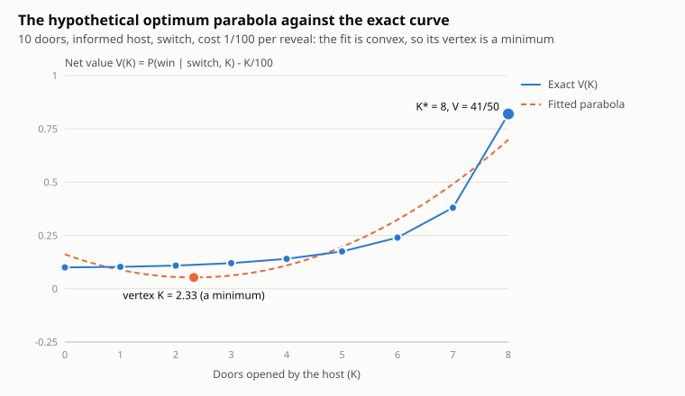

# monty-hall-decision-lab

Exact and reproducible analysis of the Monty Hall problem and its generalizations, built as a
decision lab with one shared specification and four implementations that must agree exactly:
Python (the reference), Java, PHP and C. The repository name is Spanish for "the game of the three
doors".

## Purpose

The Monty Hall problem is a standard example of how conditioning on information changes a
probability. A car is hidden behind one of three doors. You pick a door, the host opens a
different door showing a goat, and you may switch. Switching wins 2/3 of the time, which many
people find counterintuitive.

## Why this project exists

The project started as a short script demonstrating that switching helps. It is now a small,
verifiable lab for a more general question: when someone reveals information before you decide,
how much is that information worth, and what does it depend on? The answer depends on how the
host chooses what to reveal, so the host is an explicit, swappable policy, and every simulated
number can be checked against an exact fraction.

## What it does

- Models `N` doors (3 to 64), `M` prizes, a uniform or weighted prior over prize placement, the
  player's pick and `K` reveals.
- Four host policies: `informed` (classic), `random` (may reveal a prize; those games are void),
  `biased` (prefers some doors) and `adversarial` (offers a switch only when you are right).
- Three strategies: `stay`, `switch` and `mixed(q)`.
- Exact results as reduced fractions, including results conditional on which doors were opened.
- A deterministic simulator whose random stream is fully specified, so all four languages
  produce bit-identical win counts for the same seed.
- An exploration-cost model: with a cost `c` per reveal, `V(K) = P(win) - c*K`, its exact optimum
  over `K`, and a least-squares parabola fitted to `V(K)` (the "hypothetical optimum parabola").

| Doors | Reveals | Host | Stay | Switch |
| ---: | ---: | --- | ---: | ---: |
| 3 | 1 | informed | 1/3 | 2/3 |
| 3 | 1 | random, no prize revealed | 1/2 | 1/2 |
| 3 | 1 | adversarial, switch offered | 1/1 | 0/1 |
| 3 | 1 | biased, prefers door 1 with p = 3/4, door 1 opened | 3/7 | 4/7 (= 1/(1+p)) |
| 3 | 1 | biased, prefers door 1 with p = 3/4, door 2 opened | 1/5 | 4/5 (= 1/(2-p)) |
| 5 | 1 | informed | 1/5 | 4/15 |
| 64 | 62 | informed | 1/64 | 63/64 |

## Theory and the hypothetical optimum parabola

[docs/THEORY.md](docs/THEORY.md) builds from three doors to a general rule for deciding with
partial information: the update depends on how the information was generated, which is why the
four hosts give different answers for the same opened door. It derives the `N`, `M`, `K`
formulas, connects them to Bayesian updating and the value of information, and analyses the
exploration-cost model. [docs/DECISION_GUIDE.md](docs/DECISION_GUIDE.md) turns the model into
practical questions and is marked as interpretation.

The hypothetical optimum parabola is the author's modeling concept: treat reveals as exploration
with a price and approximate net value against exploration by a parabola whose vertex marks the
best amount of exploration. The lab reports both that parabola and the exact discrete optimum.
In this model the trade-off is usually not an inverted parabola:

- For the informed, biased and adversarial hosts with any prior, and the random host with a
  uniform prior, `V(K)` is provably convex, so the exact optimum is `K = 0` or the largest
  feasible `K`, and the switch from one to the other happens at a critical cost such as `1/N`.
- A committed sweep of 4,140 `optimum` calls found no concave fit and no interior optimum; the
  fitted vertex was a minimum in every convex case, while the end the parabola rates higher
  matched the exact optimum in 3,559 of 3,600 fits.
- Switching against the random host with a non-uniform prior can be slightly concave. An exact
  example with 22 doors has an interior optimum, beyond the 10-door limit the CLI enforces for
  explicit priors.

For ten doors with `c = 1/100`, the exact optimum is `K* = 8` with `V = 41/50`; the parabola's
vertex is at `K = 241371/103790` (about 2.33), and rounding it to `K = 2` would lose `249/350` of a
prize, while the highest point of the fitted parabola over the feasible range is `K = 8`.



## Repository layout

```text
spec/              Shared specification: CLI contract, PRNG, JSON Schemas, scenarios, vectors
tools/
  enumerate.py     Independent brute-force oracle for spec/scenarios.json
  conformance.py   Checks any language's CLI against spec/
  crosscheck.py    Runs random invocations through several CLIs and requires identical output
  make_figures.py  Generates docs/figures/ (SVG charts and results.json) from CLI output
  record_run.py    Stores exact, simulate and optimum output from any implementation in SQLite
db/schema.sql      SQLite schema for monty-lab results from any language
python/            Python reference implementation (package monty_hall)
  src/monty_hall/
    lab/           Decision lab: model, PRNG, exact solver, simulator, optimum, CLI contract
    domain/ analysis/ simulation/ persistence/ cli/
                   The original two-policy study tool with optional SQLite storage
  tests/           Unit, property-based, statistical, integration, and spec suites
  tools/           Test report generator, spec data generator
  db/schema.sql    Schema of the original monty-hall tool's optional run database
java/              Java 17 implementation of monty-lab, built with Maven (see java/README.md)
php/               PHP 8.4 implementation of monty-lab, built with Composer (see php/README.md)
c/                 C17 implementation of monty-lab, built with make (see c/README.md)
docs/              Theory, decision guide, architecture, security audit, figures/
```

There is no frontend or backend: these are command-line tools and a library. See
[docs/ARCHITECTURE.md](docs/ARCHITECTURE.md) and [spec/README.md](spec/README.md).

## Quick start

The Python reference requires Python 3.13 or newer and [uv](https://docs.astral.sh/uv/). There
are no runtime dependencies in Python, Java or C; PHP uses the pinned `brick/math` library for
arbitrary-precision integers. Build and test instructions for the other three are
in [java/README.md](java/README.md) (Java 17, Maven), [php/README.md](php/README.md) (PHP 8.4,
Composer) and [c/README.md](c/README.md) (C17, make).

```bash
git clone https://github.com/juanmafx/monty-hall-decision-lab.git
cd monty-hall-decision-lab/python
uv sync --locked
uv run monty-lab exact
uv run monty-lab simulate --seed 42 --trials 100000
uv run monty-lab optimum --doors 10 --strategy switch --cost 1/100
```

The same commands work with `java -jar java/target/monty-lab.jar`, `php php/bin/monty-lab` and
`c/build/monty-lab` once built, and print the same JSON.

## Usage guide

### monty-lab, the cross-language contract

```bash
uv run monty-lab exact --doors 5 --prizes 2 --reveals 2
uv run monty-lab exact --host biased --host-weights 1,3,1 --observed 1
uv run monty-lab exact --doors 4 --prior 3,1,1,1 --host random --reveals 2
uv run monty-lab simulate --host adversarial --seed 7 --trials 50000 --mixed 1/3
uv run monty-lab optimum --doors 6 --host random --strategy switch --cost 1/30
uv run monty-lab prng --seed 0 --kind words --count 4
```

Output is always JSON. The complete flag list, validation rules, output fields and exit codes are
in [spec/cli.md](spec/cli.md). Explicit priors and observed reveals use exact enumeration, which is
limited to 10 doors; simulation has no such limit.

### monty-hall, the original study tool

```bash
uv run monty-hall exact --doors 5 --opened 1
uv run monty-hall exact --host random --enumerate --format json
uv run monty-hall simulate --host random --trials 500000 --seed 7
uv run monty-hall simulate --trials 100000 --seed 1 --db runs.sqlite3
uv run monty-hall history --db runs.sqlite3 --limit 10
```

It supports the `informed` and `random` hosts with one prize, prints text or JSON, and can store
runs in SQLite. It uses Python's `random` module, so its streams are not part of the
cross-language contract.

| Flag | Commands | Default | Valid values |
| --- | --- | --- | --- |
| `--doors` | `simulate`, `exact` | `3` | 3 to 1024; `--enumerate` allows at most 9 |
| `--opened` | `simulate`, `exact` | `1` | 1 to doors - 2 |
| `--host` | `simulate`, `exact` | `informed` | `informed`, `random` |
| `--format` | `simulate`, `exact` | `text` | `text`, `json` |
| `--trials` | `simulate` | `100000` | 1 to 100,000,000 |
| `--seed` | `simulate` | generated and printed | 0 to 2^63 - 1 |
| `--confidence` | `simulate` | `0.95` | strictly between 0 and 1 |
| `--db` | `simulate`, `history` | none | SQLite file path |
| `--enumerate` | `exact` | off | flag |
| `--limit` | `history` | `20` | 1 to 1000 |

Both programs exit with code 2 and a message on standard error for invalid input, and with code
141 if the reader of standard output closes early. Neither reads environment variables or
configuration files.

## Database

Persistence is **optional**, and there are two schemas.

- [db/schema.sql](db/schema.sql) stores `monty-lab` results from any of the four
  implementations. `tools/record_run.py` applies it and loads `exact`, `simulate` and `optimum`
  JSON documents with the implementation's name and version, keeping each original document. The
  view `lab_simulation_disagreements` lists seeded simulations whose counts differ between
  recorded runs, which should always be empty.

  ```bash
  c/build/monty-lab simulate --seed 7 --trials 1000 > run.json
  python3 -I tools/record_run.py --db lab.sqlite3 --implementation c --implementation-version 3.0.1 run.json
  ```

- [python/db/schema.sql](python/db/schema.sql) belongs to the original `monty-hall` tool. It is
  applied automatically when `--db` is used with `simulate`, and `history` opens the file
  read-only. Both commands refuse a file whose run tables, views, indexes, or triggers differ from
  that schema.

## Testing

From `python/`:

```bash
uv run pytest
uv run ruff check . ../tools
uv run ruff format --check . ../tools
uv run mypy
uv run mypy --strict ../tools
uv run python -I ../tools/enumerate.py ../spec/scenarios.json --check
uv run python tools/write_spec_data.py --check
uv run python -I ../tools/conformance.py --cli "python -m monty_hall.lab"
uv run python -I ../tools/make_figures.py --cli "$PWD/.venv/bin/python -m monty_hall.lab" --check
uv run python tools/generate_test_report.py
```

Each of the other implementations has its own suite and report, described in its README: JUnit in
[java/reports/](java/reports/), PHPUnit and PHPStan in [php/reports/](php/reports/), and the C
unit tests, plain and under AddressSanitizer and UndefinedBehaviorSanitizer, in
[c/reports/](c/reports/). Each report directory also holds that implementation's conformance
result.

The suite covers input validation, PRNG vectors, property-based invariants (including that
averaging over every possible reveal recovers the unconditional result), agreement with the
independent enumerator on every scenario, statistical convergence with fixed seeds, JSON Schema
validation of every output, both databases, and both CLIs. The latest recorded run is in
[python/reports/tests/test-report.md](python/reports/tests/test-report.md).

`tools/conformance.py` takes the command that runs any implementation's CLI. It checks exact
fractions for equality, simulation counts for bit-identical equality with
`spec/simulation-reference.json`, PRNG vectors, error handling, the input syntax (full flag names,
ASCII decimal integers, fraction parts within 2^63 - 1, help before validation), one game whose
exact values are wider than 4,096 bits, and whether the exact values fall inside the Wilson 95%
intervals. About one interval in twenty is expected to miss by chance, so it
fails only when misses exceed what a 0.1% binomial tail allows, or when any deviation reaches
five standard errors.

`tools/crosscheck.py` compares implementations with each other rather than with spec/. It
generates random `exact`, `simulate` and `optimum` invocations from a fixed seed, including some
invalid ones, runs each through every CLI it is given, and fails if any exit code or JSON value
differs, floating-point fields included. The `Conformance` workflow builds all four
implementations, runs `conformance.py` against each, and then runs `crosscheck.py` across them.

## Reproducibility

`monty-lab` uses SplitMix64, xoshiro256** and Lemire's bounded draws exactly as written in
[spec/prng.md](spec/prng.md), so a seed and scenario give the same counts in any language and any
Python version. `monty-hall` keeps its original behaviour: the same seed, configuration and Python
version produce the same result. Statistical tests use fixed seeds, and property tests run
derandomized.

## Security

The tools make no network calls, have no runtime dependencies apart from PHP's `brick/math`, use
parameterized SQL and bound
their numeric options. `monty-hall` refuses SQLite files whose run tables or views differ from the
expected schema; `tools/record_run.py` does not perform that check, so use it only on database
files you created.
Neither random generator is cryptographically secure, and none needs to be. See
[SECURITY.md](SECURITY.md) and [docs/SECURITY_AUDIT.md](docs/SECURITY_AUDIT.md).

## Project history

Originally created in 2019 by Juan Manuel Ramallo as a single Python script. Rebuilt as a tested
package in version 2.0.0 and extended to the four-language decision lab in version 3.0.0, both in
2026. See [CHANGELOG.md](CHANGELOG.md).
The Monty Hall problem itself is not original to this project: it was posed by Steve Selvin in 1975
and popularized by Marilyn vos Savant. The "Monty Fall" name comes from Jeffrey S. Rosenthal.

## License

No license has been published for this repository, so default copyright applies.
