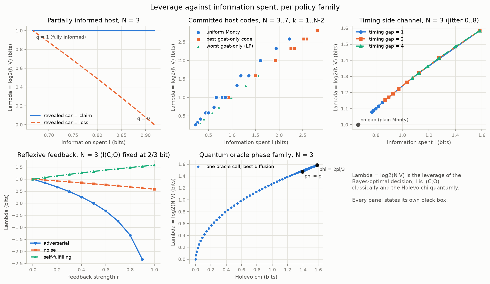
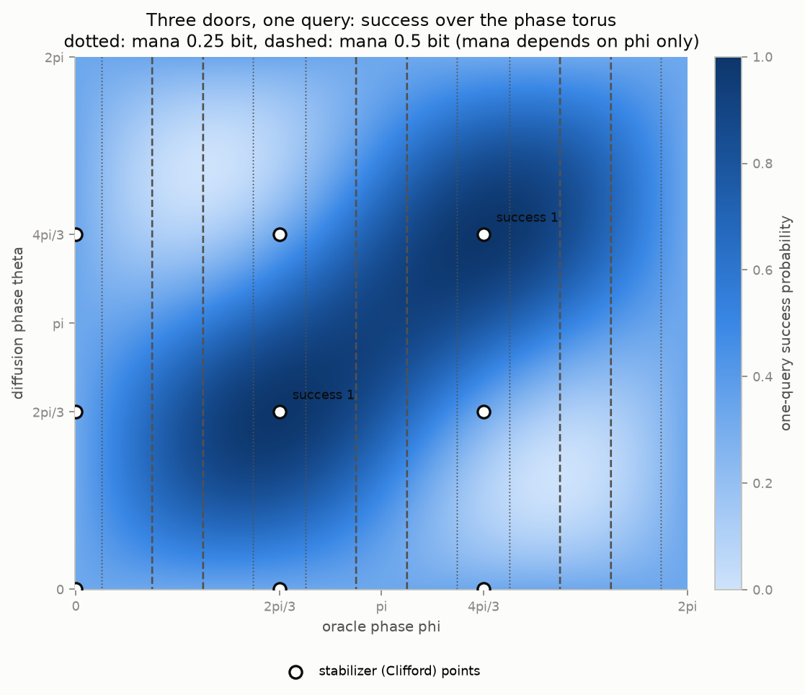
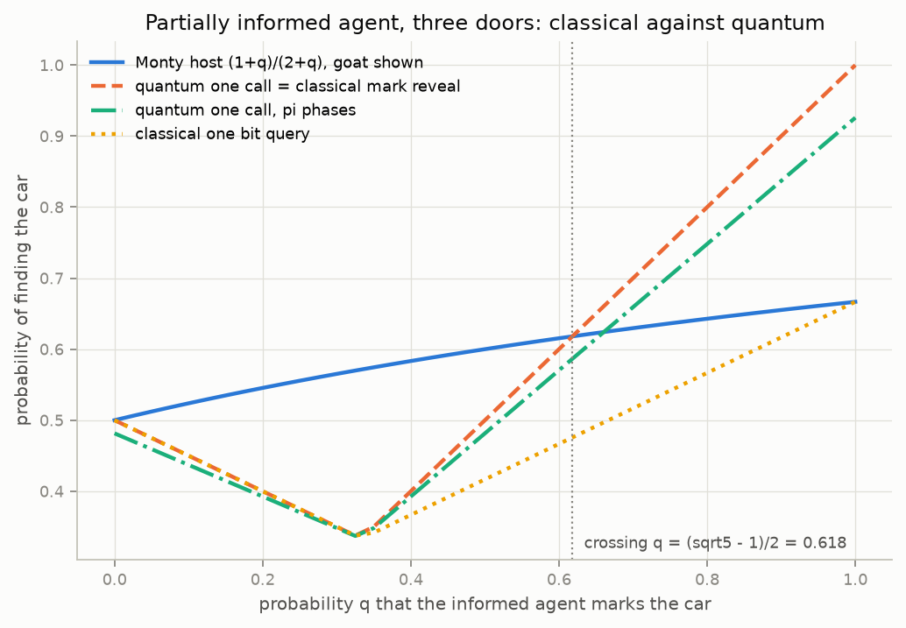
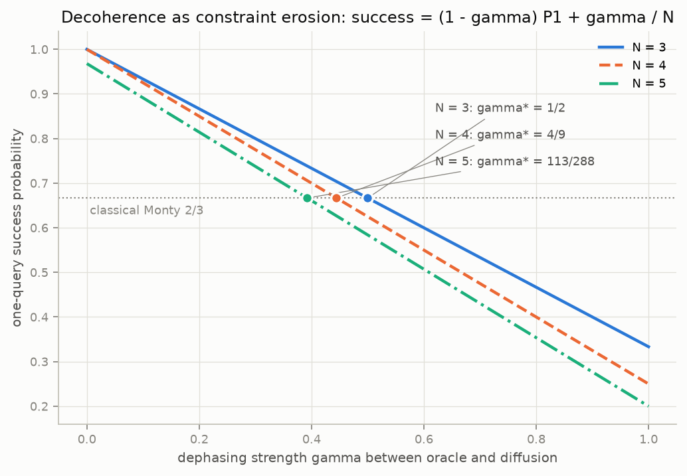
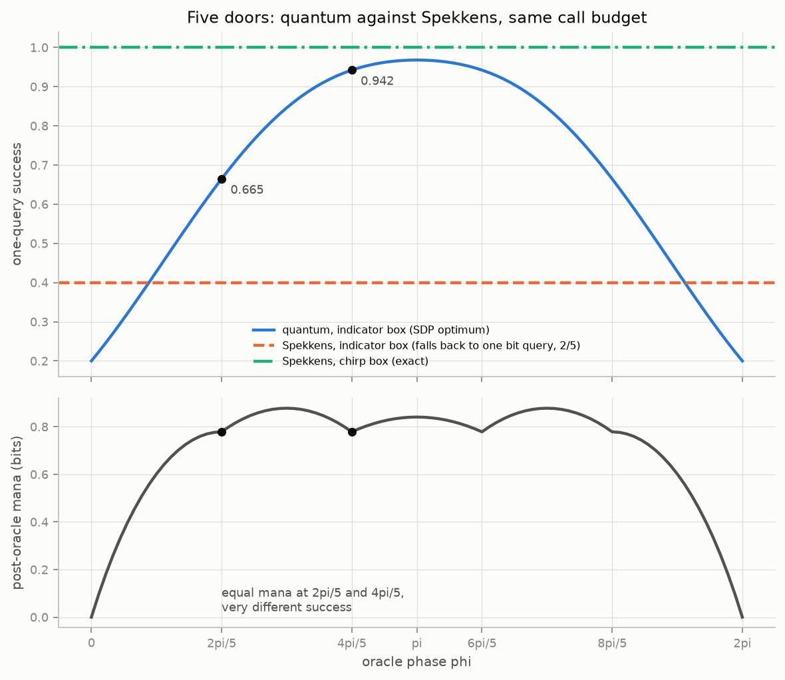

# Branching Monty: constraint as leverage, from Bayes to Spekkens to quantum

*Generated from the code in `branching_monty/`. Every number below is produced by a script in
`experiments/` and pinned by a test in `tests/`. Claims carry one of four labels: **theorem**
(proved, or exact algebra), **numerical result** (computed and regression-tested), **conjecture**,
or **analogy**.*

## Abstract

A host who must open a goat door turns a constraint into leverage on the player's decision. We
measure that leverage as Λ = log₂(N·V), where V is the Bayes-optimal success probability, and set
it against the information spent: I(C;O) classically and the Holevo χ quantumly. For the partially
informed three-door host, the switch probability conditioned on a revealed goat is
(1+q)/(2+q) with slope 1/(2+q)² (**theorem**), and the information the host releases falls from
log₂3 − 2/3 ≈ 0.918 bit to 2/3 bit as q goes from 0 to 1 (**theorem**). A committed goat-only host
can reach V* = min(N, C(N−1,k))/N, which is 1 at five doors and two reveals, while the classic
uniform Monty attains exactly the minimum V the constraint allows, verified up to seven doors
(**numerical result**). Reflexive feedback gives V(r) = (1−r)V₀ + r·x and timing gives
V = 2/3 + (1/3)·min(δ, J+1)/(J+1), independent of the latency floor (**theorem**). In the quantum
tier, one query at three doors reaches certainty only with matched phases 2π/3 or 4π/3, and the
Spekkens qutrit model reproduces that circuit step by step (**numerical result**). At five doors,
no non-trivial marking oracle is Clifford and the quantum optimum 121/125 exceeds the Spekkens
tier's 2/5 (**numerical result**). Dephasing between oracle and diffusion lowers success
affinely, so the threshold γ* has the closed form (P₁ − T)/(P₁ − 1/N) (**theorem**).

## 1. The core library and the regression table

The first module turned eleven values from earlier analysis into tests, and all eleven survived.
The switch probability of the partially informed host is P(q) = (1+q)/(2+q): 1/2, 5/9, 3/5,
7/11 and 2/3 at q = 0, ¼, ½, ¾, 1. One query of standard Grover search on three doors succeeds
with probability 25/27; with phases matched at 2π/3 or 4π/3 it succeeds with certainty. Holevo
χ after one oracle call is 1.392 bits for the π phase and log₂3 = 1.585 bits for the 2π/3 phase,
and the optimal guessing probabilities, computed both by square-root measurement and by SDP, are
25/27 and 1. In both cases Grover's diffusion is already the optimal discriminator
(**numerical result**).

Two corrections came out of this module, and both matter for the rest of the report.

**Finding 1 (numerical result).** The certainty result needs the oracle and the diffusion to use
the *same* phase. Mixing 2π/3 with 4π/3 drops success to exactly 1/3, which is no better than
guessing.

**Finding 2 (theorem).** The slope dΛ/dI is negative across the partially informed host family
*only* when a revealed car counts as a loss. Then V = (1+q)/3 and Λ = log₂(1+q) rises while I
falls. If the player may claim a revealed car, V = 2/3 for every q, Λ is a flat 1 bit, and the
slope is zero. The first panel of Figure 1 shows both lines.

The Wigner function adds a third observation. The exact 2π/3 circuit stays Wigner-non-negative
at every step (mana 0). The π-phase oracle drives the minimum to −1/9, with mana
log₂(13/9) ≈ 0.531 bit (**numerical result**; the closed form was found here and is now a
regression target).

## 2. The branch engine

Module 2 represents the game the way the 2019 Branching text imagines reality: each branch is a
complete hypothesis (where the car is, whether the host knows), each observation prunes branches
by Bayes' rule, and every branch keeps its full weight history in a warehouse. The engine works in
exact rational arithmetic. It matches the existing decision lab's solver fraction for fraction
for the informed and random hosts, from three to seven doors and for every number of reveals, and
a seeded Monte Carlo run agrees within four standard errors (**numerical result**). Branch pruning
is Bayesian elimination, with nothing beyond it.

## 3. Two agents exchanging messages

Module 3 split the game into two processes: CPU A hosts, CPU B infers. Throughout, "k messages"
means one message that opens k doors at once. That interpretation was chosen in Module 3 and is
kept here.

**Finding 3 (numerical result).** If the host may only open goat doors but commits in advance to
a code, the best achievable value is V* = min(N, C(N−1,k))/N under a uniform prior. At five doors
and two reveals, V* = 1: the host can tell the player exactly where the car is without ever
opening it. At four doors and one reveal, V* = 3/4 against the uniform Monty's 3/8. The
constraint does not cap information; the host's policy does.

**Finding 4 (numerical result).** The classic uniform Monty attains exactly the *minimum* V that
the goat-only constraint allows, for every shape from three to seven doors. Among all hosts who
obey the same rule, the textbook one is the least helpful.

**Finding 7 (method).** Maximising V over policies is the maximisation of a convex function, not a
linear program. Under the goat-only constraint the optimum equals a maximum-weight bipartite
matching between car positions and messages, which *is* a linear program with an integral
solution, so `linprog` solves it exactly. The adversarial minimum is a separate, standard LP.
Lifting the goat-only rule and keeping only "never open the player's door" makes the problem
trivial: full disclosure gives V = 1 (**theorem**).

**Finding 5 (theorem).** Reflexivity, meaning B's committed choice feeding back into where the
car ends up with strength r, gives V(r) = (1−r)·V₀ + r·x. Here x = 0 when the world moves the car
away from the prediction, 1/(closed doors) for pure noise, and 1 for a self-fulfilling influence.
Leverage falls with r only when the influence works against the prediction, and it rises when the
influence is self-fulfilling. A player who knows r cannot escape the adversarial case, because
every choice is hit equally. At three doors the adversarial curve is Λ(r) = 1 + log₂(1−r)
bits, plotted in the fourth panel of Figure 1.

**Finding 6 (theorem).** Latency on its own carries no leverage. With a host whose processing
time is τ + δ·(choices − 1) and a delay uniform on [L, L+J], three-door value is
V = 2/3 + (1/3)·min(δ, J+1)/(J+1), and it does not depend on L at all. The gain is a timing side
channel: it exists only if the sender's processing time depends on what it knows and the jitter J
is smaller than that difference δ. With J = 0 and δ ≥ 1, the player wins with certainty. Every
seeded simulation enforces arrival ≥ emission + L, and a test checks it.

All 228 experiment rows of Module 3 agree with the exact values within four standard errors.



*Figure 1. Leverage Λ against information spent, one panel per policy family. Reflexivity is
plotted against r, because it leaves I(C;O) fixed at 2/3 bit.*

## 4. Three tiers on the same black box

For each experiment the black box is stated before any comparison, together with how many calls
each tier receives and what a call returns. Comparing tiers that receive different boxes was the
main risk flagged in earlier analysis.

### 4.1 The Spekkens qutrit tier

The tier lives on the phase space ℤ₃ × ℤ₃. Its pure epistemic states are the 12 lines (cosets),
its dynamics are the 216 affine symplectic maps, and a measurement reveals a coset and
randomises the conjugate quadrature. A compiler takes any unitary and either returns the affine
symplectic map it induces on Gross's phase-point operators or proves that none exists.

**Numerical result.** For every target and both matched phases, the Spekkens tier reproduces the
quantum Wigner function at every step of the exact search, every intermediate state is a line,
and the final position measurement is one-hot on the target. In phase-space terms, the oracle is
a shear p → p + x + c(t) and the diffusion is a shear x → x + 2p. Among 36 evenly spaced oracle
phases, the Clifford ones are exactly {0, 2π/3, 4π/3}. The π-phase oracle and the π-phase
diffusion have no affine symplectic representative, so the Spekkens tier cannot implement them.

### 4.2 The phase grid

Black box: one call to O_t = diag(e^{iφ[x=t]}) on a qutrit, uniform preparation, diffusion with
phase θ, computational measurement. On the 721 × 721 grid, success reaches 1 only at the two
matched stabilizer points (2π/3, 2π/3) and (4π/3, 4π/3). Of the nine stabilizer points, those
two give 1 and the other seven give 1/3. The Spekkens tier's best one-query success is also 1,
so the quantum-minus-Spekkens residual is never positive at three doors.

**Numerical result: the residual is not a monotone function of mana.** It is not even a function
of mana. φ = 0 and φ = 2π/3 both have mana 0, yet their best success is 1/3 and 1. Over the whole
grid the Spearman correlation between mana and residual is −0.31. At three doors magic does not
buy success; the best protocol uses none.



*Figure 2. One-query success over the oracle and diffusion phases, with mana contours and the
stabilizer points.*

### 4.3 The partially informed quantum oracle

Black box: one call to a phase oracle that marks the car with probability q and a uniformly
random wrong door otherwise. This is a mixed channel. The player then measures and guesses
optimally.

**Numerical result.** With matched phases, quantum success is max(q, (1−q)/2), and the SDP
optimum over all measurements gives the same number. This is exactly what a *classical* oracle
that reveals its mark achieves with one call. With one query, the quantum tier gains nothing over
a classical box of equal power. Against the Monty host (a different black box: the host opens a
goat door), the curves cross where (1+q)/(2+q) = q, at q = (√5 − 1)/2 ≈ 0.618 (**theorem**).
Below that point the constrained host is worth more, and above it the marking oracle is.



*Figure 3. Success against the oracle's reliability q, for four black boxes.*

### 4.4 Decoherence as constraint erosion

Black box: one oracle call, then dephasing ρ → (1−γ)ρ + γ·diag(ρ), then diffusion. Because the
oracle is diagonal, the dephased part is the maximally mixed state, which the diffusion leaves
unchanged. Success is therefore exactly affine in γ: (1−γ)·P₁ + γ/N (**theorem**). The threshold
where success meets T is

> γ* = (P₁ − T) / (P₁ − 1/N),

with P₁ = 1 at N = 3 and P₁ = (3N − 4)²/N³ for N ≥ 4. That value is sin²(3·arcsin(1/√N)), the
standard one-query Grover success. The affine form is a theorem given P₁. That standard phases
are optimal for N ≥ 4 is a **numerical result**, checked by grid and local search up to N = 7.
At T = 2/3, γ* = 1/2, 4/9 and 113/288 for N = 3, 4, 5. At the classical one-query threshold
T = 2/N, γ* = 1/2, 2/3 and 71/96. Root-finding on the simulated channel agrees to 1e-10.



*Figure 4. Success against dephasing strength for N = 3, 4, 5, with γ* at the classical Monty
level.*

### 4.5 Five doors

At d = 5 the indicator is δ(x, t) = 1 − (x − t)⁴, a degree-4 polynomial, so no non-trivial phase
oracle on the marked door is Clifford. The compiler confirms this for every phase 2πk/5 and for
π (**numerical result**). The Spekkens tier therefore cannot call this black box. Its best
one-query strategy falls back to one classical bit query, worth 2/5. The best quantum one-query
protocol reaches 121/125 = 0.968 at φ = π, by SDP and by Grover alike.

**Numerical result: a strict gap of 0.568 appears at five doors where three doors show none.**
It comes with two caveats that change how to read it. First, the gap does not track mana:
φ = 2π/5 and 4π/5 have identical mana, 0.7787 bit, but succeed with 0.665 and 0.942. The
correlation is positive (Spearman 0.73) but not monotone. Second, the gap belongs to the black
box, not to the number of doors. Given a chirp box diag(ω^{(x−t)²}), which is Clifford for every
odd prime d, the Spekkens tier finds the car with certainty at both three and five doors.



*Figure 5. Five doors: quantum against Spekkens with the same call budget (top), and
post-oracle mana (bottom).*

### 4.6 The optional qubit run

Qiskit 2.6.2 installed cleanly as an optional dependency group. With N = 4, the oracle CPhaseGate(φ)
marks |11⟩ and the standard diffusion follows. Statevector success matches the NumPy model to
1.3e-15 across 73 phases. Qiskit recognises the oracle as Clifford only at φ ∈ {0, π, 2π}, and
φ = π gives certainty (**numerical result**).

## 5. What Branching Logic gets right and what it does not

The 2019 text describes reality as branching and collapsing, two processors exchanging messages,
and stages that end in what it calls time travelling. Here is what each stage survives as, once
it is rewritten as a quantity a script computes.

**Branch pruning (right, and exactly classical).** Keeping every alternative and discarding the
ones observations rule out is Bayesian elimination. The branch engine does this and matches an
independent solver fraction for fraction. "Discovering a reality before it is reached" has a
sound reading: once a branch's posterior reaches 1, later observations cannot change the
decision. This is anticipation by inference. It never acts on the past, and the report makes no
claim of causality violation or time travel.

**Imagining realities to predict ours (right, with a price tag).** The leverage metric gives
"how much does imagining the branches help" a number. Λ is bounded by log₂N, and the information
the host releases fixes how much of that bound is reachable. The signalling results add a twist
the text did not anticipate: what limits prediction is the sender's code, not the rule the
sender obeys.

**Influencing the system you are part of (half right).** Reflexivity is real and measurable, but
its sign decides everything. Influence that works against your prediction destroys leverage, down
to Λ = 1 + log₂(1−r) at three doors. Influence that fulfils it creates leverage. The original text
treats influence as an advantage, and that holds only for the self-fulfilling sign.

**Two CPUs and latency (right only through a side channel).** Separating two processors by a
delay gives no leverage by itself: Λ does not depend on the latency floor. What does give
leverage is a state-dependent timing side channel. If the sender's processing time depends on its
hidden state, and the jitter is smaller than that dependence, the receiver can prune branches by
arrival time. This applies directly to the Rust `branching` repository: its delay anomalies carry
information only if `gva`'s or `dfw`'s emission timing depends on internal state. Otherwise they
measure the network, not reality.

**Realities collapsing each other (an analogy that holds only partway).** Interference, where
amplitudes from different branches cancel, is the mechanism the phrase gestures at (**analogy**).
Classical hardware reaches the Spekkens tier and no further. That tier already reproduces the
three-door certainty result, so at three doors nothing genuinely quantum is needed. The first
strict quantum gap appears at five doors, and even there it depends on which black box is
granted.

## 6. Results that matter

**(a) Residual monotone in mana: did not hold.** At three doors the residual is not a function of
mana: two mana-zero phases give 1/3 and 1, and the Spearman correlation is −0.31. At five doors the
correlation is positive (0.73), but equal mana gives success 0.665 and 0.942.

**(b) A strict gap at N = 5 where N = 3 shows none: held, with a caveat.** The gap is
121/125 − 2/5 = 0.568 for the indicator box and zero at three doors. A chirp box removes it, so
it measures what the black box lets the classical tier do, not the number of doors.

**(c) A closed-form γ\*: held.** γ* = (P₁ − T)/(P₁ − 1/N), with P₁ = 1 at three doors and
(3N − 4)²/N³ from four doors up. The formula is exact given P₁, and the optimality of P₁ for
N ≥ 5 is numerical.

**(d) A reflexivity cost curve usable for Arbor's branch scoring: held.**
Λ(r) = log₂(N·((1−r)V₀ + r·x)) is closed-form, sign-dependent and verified by Monte Carlo. A branch
scorer can subtract it as a penalty whenever a hypothesis's own action feeds back into the
outcome it predicts.

## Reproducing

```bash
cd branching_monty && uv sync && uv run pytest
cd .. && uv run --project branching_monty python -m branching_monty.experiments.make_figures
```

Each experiment's command and flags are listed in `branching_monty/README.md`.
