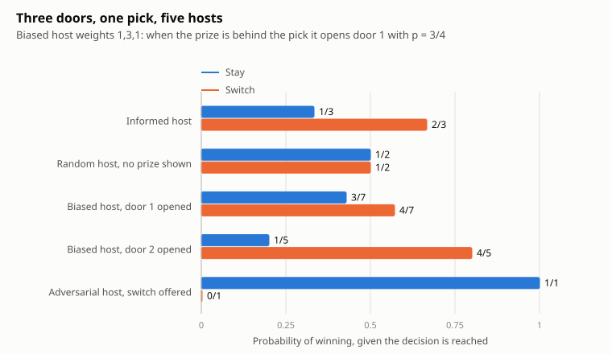
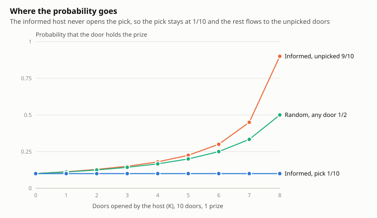
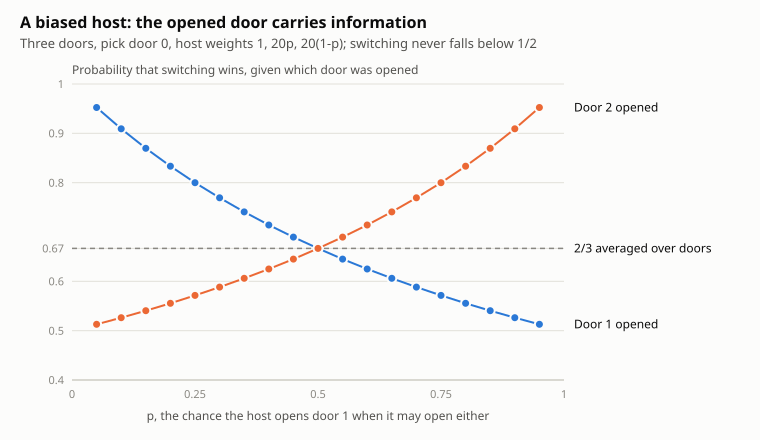
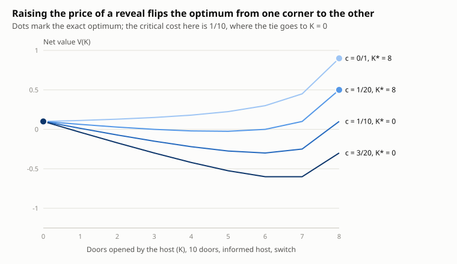
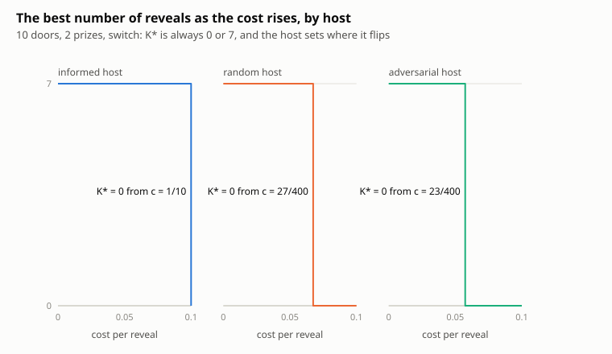
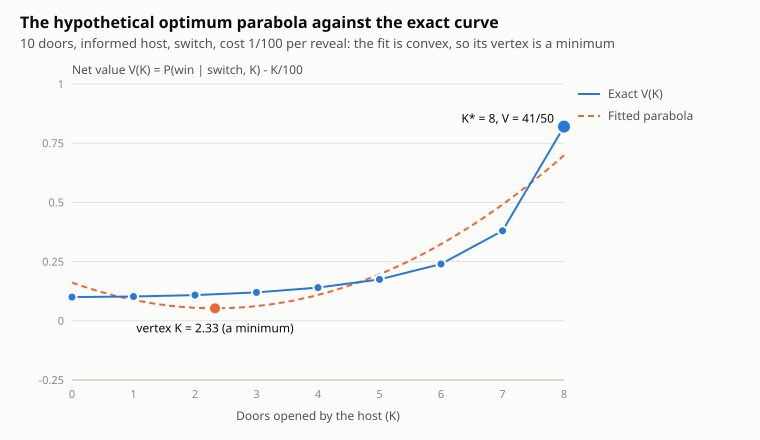

# Deciding with partial information: from three doors to a general rule

This essay explains what the lab computes and why. It starts with the classic three-door game,
derives exact results for `N` doors, `M` prizes and `K` reveals under four host policies, and
ends with the exploration-cost model and the "hypothetical optimum parabola". Every number
quoted here is either derived in the text or produced by the `monty-lab` command line; the
charts and the data behind them are generated by [`tools/make_figures.py`](../tools/make_figures.py)
into [`figures/`](figures/), and [`figures/results.json`](figures/results.json) holds every value
the charts and the summary tables use.

The practical reading of these results is in [DECISION_GUIDE.md](DECISION_GUIDE.md). That
document is interpretation; this one sticks to what can be derived or computed.

## 1. Notation

- Doors are numbered `0 .. N - 1`. The prize set `S` has `M` doors and is drawn from a prior:
  uniform over all `M`-subsets, or sequential draws without replacement in proportion to integer
  weights.
- The player's pick is the door `d`, and `pi = P(d in S)` is the prior probability that the pick
  holds a prize. For a uniform prior `pi = M / N`.
- The host opens a set `O` of `K` doors, never including `d`. `1 <= M <= N - 2` and
  `0 <= K <= N - M - 1`, so at least one closed door other than the pick always remains.
- **Stay** wins if `d in S`. **Switch** moves uniformly to one of the `N - 1 - K` closed doors
  other than the pick. **Mixed(q)** switches with probability `q`.
- All win probabilities are conditional on the player reaching the stay-or-switch decision. For
  the random host that means "no prize was revealed"; for the adversarial host it means "a switch
  was offered". This is the reading the specification fixes in [spec/cli.md](../spec/cli.md).

## 2. Three doors

One prize, three doors, the player picks door 0, and the host opens one of doors 1 and 2. Write
`h(O | S)` for the probability that the host opens `O` when the prize is at `S`. Bayes' rule
gives the posterior of each prize position after seeing door 2 opened:

```text
P(S = s | O = {2}) = P(S = s) h({2} | s) / sum over t of P(S = t) h({2} | t)
```

With the classic **informed host** (it never opens the pick or the prize, and chooses uniformly
when it has a choice):

| Prize at | Prior | `h({2} given prize there)` | Prior times likelihood | Posterior |
| --- | ---: | ---: | ---: | ---: |
| door 0 (pick) | 1/3 | 1/2 | 1/6 | 1/3 |
| door 1 | 1/3 | 1 | 1/3 | 2/3 |
| door 2 | 1/3 | 0 | 0 | 0 |

Staying wins `1/3`, switching wins `2/3`. The opened door's third did not spread evenly over the
two closed doors. It went entirely to door 1, because door 1 was exposed to elimination and
survived, while the pick was never at risk.

Change only the host and the same observation, "door 2 opened and it was empty", means
something else. The first chart shows the exact results that `monty-lab exact` reports for five
three-door situations:



| Host | Stay | Switch |
| --- | ---: | ---: |
| informed | 1/3 | 2/3 |
| random, no prize shown | 1/2 | 1/2 |
| biased with weights 1,3,1, door 1 opened | 3/7 | 4/7 |
| biased with weights 1,3,1, door 2 opened | 1/5 | 4/5 |
| adversarial, switch offered | 1/1 | 0/1 |

The doors, the prize and the physical event are identical in every row. Only the process that
chose what to show differs, and it moves the switching probability anywhere from 0 to 4/5.

## 3. The general rule

Write the posterior odds that the pick is right against the alternative:

```text
P(d in S | E)       P(d in S)       P(E | d in S)
-------------- = ------------- x ------------------
P(d not in S | E)  P(d not in S)   P(E | d not in S)
```

`E` is everything the host's behaviour revealed: which doors were opened, and the fact that the
game continued. The prior odds are fixed before the host acts. Everything the host can tell you
about your pick is in the **likelihood ratio** `P(E | d in S) / P(E | d not in S)`, and that ratio
is a property of the host's procedure, not of the doors.

This gives the principle the rest of the essay develops:

> When constraints are released by a process that knew the answer and could not eliminate your
> choice, the options that could have been eliminated and were not absorb the probability that
> the eliminated options lost. Your protected choice keeps its prior probability, but only when
> the process behaves the same way whether or not your choice is right. Whenever that condition
> fails, the update is set by how the information was generated, not by what was shown.

Three ways the condition can fail appear in the lab:

- the process does not know the answer, so your choice was exposed too (random host);
- the process knows the answer but its choice among valid doors carries a preference, so the
  door it opened is itself evidence (biased host);
- the process decides whether to release anything at all based on whether you are right
  (adversarial host).

### Conservation of probability mass

Under any host, the expected number of prizes is `M`. Under a host that never opens a prize
door, the opened doors hold none, the pick holds `pi` in expectation as long as the likelihood
ratio is 1, and the `N - 1 - K` closed unpicked doors therefore hold `M - pi` between them. Before
any reveal those same `M - pi` expected prizes were spread over `N - 1` doors. Opening doors does
not remove probability; it concentrates the unpicked share on fewer doors.



With ten doors and one prize, the pick stays at `1/10` against the informed host, and each closed
unpicked door rises from `1/10` to `9/10` as the host opens eight doors. Against the random host
every closed door, the pick included, rises together to `1/2`.

## 4. Four hosts, exact formulas

### 4.1 Informed host

It never opens the pick or a prize door, and chooses uniformly among the valid `K`-subsets.

**Unconditional result, any prior.** Staying wins exactly when the pick holds a prize, so
`P(stay) = pi`. If the pick holds a prize (probability `pi`), the other `M - 1` prizes are all among
the `N - 1 - K` closed unpicked doors, because none was opened; if it does not (probability
`1 - pi`), all `M` are. A uniform move among those doors therefore wins with probability

```text
P(switch) = (pi (M - 1) + (1 - pi) M) / (N - 1 - K) = (M - pi) / (N - 1 - K)
```

For three doors this is `(1 - 1/3) / 1 = 2/3`. For five doors and one reveal it is
`(1 - 1/5) / 3 = 4/15`, which is still better than staying (`1/5`) but far from the classic two
thirds, because the switcher must still guess among three closed doors. Switching beats staying
exactly when `(M - pi) / (N - 1 - K) > pi`.

**Conditional on the observed set, uniform prior.** Every permutation of the unpicked doors leaves
the uniform prior and the host's procedure unchanged and maps any `K`-subset of them to any other.
So `P(d in S | O)` is the same for every observed `O`, and it must then equal its average over `O`,
which is `pi`. The pick is protected and the likelihood ratio is exactly 1. For one prize this can
be checked directly: `P(O | d in S) = 1 / C(N - 1, K)`, and when the prize is at one of the
`N - 1 - K` doors outside `O`, the host opens `O` with probability `1 / C(N - 2, K)`, so

```text
P(O | d not in S) = ((N - 1 - K) / (N - 1)) / C(N - 2, K) = 1 / C(N - 1, K)
```

using `C(N - 2, K) = C(N - 1, K) (N - 1 - K) / (N - 1)`. The ratio is 1.

With a weighted prior the unconditional formula still holds, but a particular observed set can
move the pick, because the prior itself is not symmetric. With four doors, prior weights
`1,1,1,3` and one reveal, the pick's prior is `1/6`; `monty-lab exact` reports `P(stay) = 1/7`
when door 1 is opened and `1/4` when door 3, the heavily weighted door, is opened. The lab solves
these cases by exact enumeration of prize sets, which the specification limits to 10 doors.

### 4.2 Random host ("Monty Fall")

It opens `K` of the `N - 1` unpicked doors uniformly, without knowing where the prizes are. Games
in which it reveals a prize are void. The name "Monty Fall" for this variant is Jeffrey S.
Rosenthal's.

The host's choice of `O` does not depend on `S`, but the event "no prize in `O`" does. It depends
only on how many prizes are among the unpicked doors: `M - 1` if the pick holds one, `M` if not.

```text
a = P(no prize revealed | d in S)     = C(N - M, K) / C(N - 1, K)
b = P(no prize revealed | d not in S) = C(N - 1 - M, K) / C(N - 1, K)
P(decision) = pi a + (1 - pi) b
P(stay)     = pi a / P(decision)
P(switch)   = (pi a (M - 1) + (1 - pi) b M) / ((N - 1 - K) P(decision))
```

These hold for any prior, because `a` and `b` depend only on the count of prizes behind the
unpicked doors. The likelihood ratio for the pick is

```text
a / b = C(N - M, K) / C(N - 1 - M, K) = (N - M) / (N - M - K)  > 1 when K > 0
```

so surviving the reveal is evidence **for** the pick: when the pick holds a prize there are fewer
prizes elsewhere to expose. With a uniform prior, conditioning on "these `K` doors are empty"
leaves the prizes uniform over the `N - K` closed doors, so

```text
P(stay) = P(switch) = M / (N - K),     P(decision) = C(N - M, K) / C(N, K)
```

The second expression is what `pi a + (1 - pi) b` simplifies to when `pi = M / N`. Both agree
with the CLI for every valid game with 3 to 11 doors (`results.json`, key
`random_uniform_closed_form`). For three doors, `P(decision) = 2/3`, and given no prize was
shown, staying and switching both win `1/2`. The opened door carried information, but it
treated the pick and the other closed door alike, so it cannot tell you to switch.

### 4.3 Biased host

Like the informed host it never opens the pick or a prize door, but it draws its `K` doors one at a
time in proportion to positive integer weights.

**Unconditional result.** The argument in 4.1 used only the fact that no prize is ever opened, so
it applies unchanged: `P(stay) = pi` and `P(switch) = (M - pi) / (N - 1 - K)`. Averaged over what
the host might open, a preference costs and gains nothing.

**Conditional result, three doors.** Pick door 0, and let `p = w1 / (w1 + w2)` be the chance that
the host opens door 1 when both doors 1 and 2 are valid, which happens only when the prize is
behind the pick.

```text
door 1 opened:  P(stay) = (p/3) / (p/3 + 1/3)         = p / (1 + p)      P(switch) = 1 / (1 + p)
door 2 opened:  P(stay) = ((1-p)/3) / ((1-p)/3 + 1/3) = (1 - p)/(2 - p)  P(switch) = 1 / (2 - p)
```

If the pick is wrong, the prize is equally likely to be behind door 1 or door 2 and the host's
move is forced, so each observation has probability `1/2`. The likelihood ratio for the pick is
therefore `2p` when door 1 opens and `2(1 - p)` when door 2 opens, and the posterior odds for the
pick are `p` and `1 - p`. When `p > 1/2`, seeing the host do what it prefers is mild evidence for
the pick; seeing it do what it avoids is strong evidence against. With host weights `1,3,1`, `p = 3/4`, and the lab reports `4/7` and `4/5`.



The chart sweeps `p` from `1/20` to `19/20` through `monty-lab exact` with host weights
`1, 20p, 20(1 - p)`. Every computed value equals `1 / (1 + p)` or `1 / (2 - p)` exactly
(`results.json`, keys `matches_one_over_one_plus_p` and `matches_one_over_two_minus_p`). Switching
never wins less than `1/2`, and averaged over which door the host actually opens, the two curves
give back the unconditional `2/3`. In the extreme `p = 1`, a host that always opens door 1 when
it may, opening door 2 means the prize is certainly behind
door 1. Rosenthal calls this variant "Monty Crawl".

For more doors the lab computes the probability that a biased host opens a given set by summing
over the orders in which it could have drawn that set, and enumerates prize sets exactly.

### 4.4 Adversarial host

When the pick holds no prize the game ends with no offer. Otherwise the host opens `K` doors like
the informed host and offers the switch. The **offer itself** is the information:

```text
P(offer)  = pi
P(stay | offer)   = 1
P(switch | offer) = (M - 1) / (N - 1 - K)
```

The likelihood ratio for the pick, given an offer, is infinite: an offer never happens when the
pick is wrong. With one prize, switching after an offer always loses. Opening doors changes
nothing here, because the decisive information was released by the decision to make an offer.

### 4.5 Summary

| Host | Decision reached with probability | Stay | Switch | Likelihood ratio for the pick |
| --- | --- | --- | --- | --- |
| informed | 1 | `pi` | `(M - pi) / (N - 1 - K)` | 1 with a uniform prior |
| random | `pi a + (1 - pi) b` | `pi a / P(decision)` | see 4.2 | `(N - M) / (N - M - K)` |
| biased | 1 | `pi` on average | `(M - pi) / (N - 1 - K)` on average | depends on the opened set |
| adversarial | `pi` | 1 | `(M - 1) / (N - 1 - K)` | infinite |

The mixed strategy wins `(1 - q) P(stay) + q P(switch)` in every case. The lab's solver uses
these closed forms where they apply and exact enumeration otherwise, and the independent
enumerator in `tools/enumerate.py` checks them on every scenario in `spec/scenarios.json`.

## 5. Bayesian updating, stated plainly

Every result above is one application of Bayes' rule with a different likelihood. Nothing about
doors is special. The pattern is:

1. Fix the hypotheses (where the prizes are) and their prior.
2. Model the **process** that produced what you saw: who chose it, what they knew, what they
   could not do, what they preferred, and whether you would have seen anything at all under
   other hypotheses.
3. Multiply prior by likelihood and renormalize.

The common error in the three-door puzzle is to skip step 2 and treat "door 2 is empty" as a
fact about the world that rules out one hypothesis and leaves the others in their old
proportions. That is the correct update only for a process like the random host, whose
behaviour does not depend on the answer except through what it happens to expose. For a process
that knew the answer, the same fact carries the additional information "this is what the host
chose to show, knowing where the prize was".

The informed host is the case in which knowledge and protection exactly cancel for the pick and
leave all the information on the other doors. The biased host shows that knowing the answer is
not enough for the pick to keep its prior; the selection among valid options must also be
independent of whether the pick is right. The adversarial host shows the other extreme: an
informed process can release information through the decision to speak at all.

## 6. The value of information

The value of a piece of information to a decision is the expected payoff of the best decision
made with it, minus the expected payoff of the best decision made without it. Two different
things change when the host opens doors, and it helps to separate them.

**Decision value.** For a fixed situation after the reveal, compare the best action with the
action you would have taken anyway. Against the informed three-door host, a player who would
otherwise stay wins `1/3`, and using the information to switch wins `2/3`: the reveal is worth
`1/3` of a prize. Against the biased host with door 2 opened it is worth `4/5 - 1/5 = 3/5`, and
with door 1 opened `4/7 - 3/7 = 1/7`. Against the random host it is worth nothing: both actions
win `1/2`, so no decision changes.

**Selection.** Against the random host, staying rises from `1/3` to `1/2` given no prize was
shown. Nothing the player did caused that; the games in which the pick was right were simply
more likely to survive. The lab's random-host numbers are conditional on survival, and
`outcomes.void` reports how often the condition fails. Reading a conditional win rate as if it
were what a strategy earns before the reveal is a selection error.

**Increasing returns from informed reveals.** For the switching player against an informed host,
the gain from the `K`-th reveal is

```text
P(switch | K) - P(switch | K - 1) = (M - pi) / ((N - 1 - K)(N - K))
```

which grows with `K`: each reveal concentrates the same `M - pi` on fewer doors, and the last
reveals do the most. With ten doors and one prize the first reveal adds `1/80` and the eighth adds
`9/20`. This shape, small early gains and large late ones, is what drives the optimum results in
section 7.

## 7. Exploration with a price: the optimum curve

Treat each reveal as exploration that costs `c`, measured in units of the prize. A player who
commits in advance to `K` reveals and then follows a strategy has net value

```text
V(K) = P(win | strategy, K) - c K,     K = 0 .. N - M - 1
```

`monty-lab optimum` evaluates `V(K)` exactly at every feasible `K` and reports the discrete
maximum `K*` (ties go to the smaller `K`). This is a stylised explore-versus-commit trade-off:
each unit of exploration narrows the field before you commit, and the question is how much of it
to buy.

### 7.1 The optimum is always at a corner in the proven cases

A real function `f` is convex on an interval when its chords lie above it; a convex function on
a finite set of consecutive integers takes its maximum at one of the two ends. So whenever
`V(K)` is convex, `K*` is either 0 or the largest feasible `K`: buy no exploration, or buy all of
it.

- **Informed and biased hosts, any prior.** `pi` does not depend on `K`, so `P(stay) = pi` is
  constant and `P(switch) = (M - pi) / (N - 1 - K)` is a positive constant times the reciprocal
  of a positive, decreasing affine function of `K`, which is convex.
- **Adversarial host, any prior.** `P(stay | offer) = 1` and `P(switch | offer) =
  (M - 1) / (N - 1 - K)`: constant and convex.
- **Random host, uniform prior.** `P(stay) = P(switch) = M / (N - K)`: convex.
- **Random host, any prior, staying.** Since `b / a = (N - M - K) / (N - M)`,
  `P(stay) = 1 / (1 + rho (N - M - K) / (N - M))` with `rho = (1 - pi) / pi`, again the reciprocal
  of a positive affine decreasing function, so convex.
- **Mixed strategies** are convex combinations of the two, and subtracting `c K` keeps convexity.

The one case not covered is **switching against the random host with a non-uniform prior**, and
there the claim is false in general. Section 8.3 gives an exact counterexample.

### 7.2 The critical cost

Because `V` is convex in the cases above, comparing the two ends decides everything:

```text
K* = Kmax  if  c < c*,   K* = 0  otherwise,   c* = (P(win | Kmax) - P(win | 0)) / Kmax
```

For a uniform prior and `Kmax = N - M - 1`:

| Host and strategy | `P(win | 0)` | `P(win | Kmax)` | Critical cost `c*` |
| --- | --- | --- | --- |
| informed or biased, switch | `M / N` | `(N - 1) / N` | `1 / N` |
| informed or biased, mixed(q) | `M / N` | `(1 - q) M / N + q (N - 1) / N` | `q / N` |
| random, switch | `M / N` | `M / (M + 1)` | `M / (N (M + 1))` |
| adversarial, switch | `(M - 1) / (N - 1)` | `(M - 1) / M` | `(M - 1) / (M (N - 1))` |
| informed, biased or adversarial, stay | constant | constant | 0: never pay for reveals |

For the informed switcher the critical cost does not depend on the number of prizes. With any
prior it is `(M - pi) / (M (N - 1))`, which reduces to `1 / N` when `pi = M / N`. The script
checks the uniform-prior rows of this table against the CLI for every `N` from 4 to 16 and `M`
from 1 to 3: it computes `c*` from the CLI's curve, confirms it equals the formula, and confirms
that the CLI's `K*` is 0 at `c = c*` and `Kmax` at `c = c* - 10^-9` (`results.json`, key
`critical_costs`, every entry true).



With ten doors and one prize, `c* = 1/10`. At `c = 0` and `c = 1/20` the best plan is to let the
host open all eight doors; at `c = 1/10` the two ends tie at `1/10` and the tie goes to `K = 0`; at
`3/20` opening nothing is strictly best.

### 7.3 How the optimum shifts with the host



With ten doors and two prizes the switcher's `K*` drops from 7 to 0 at `c* = 1/10` against the
informed host, `1/15` against the random host and `1/18` against the adversarial host. The chart
samples costs in steps of `1/400`, so it shows the first sampled cost at or above each critical
value. A host whose reveals carry less decision value supports a lower price for exploration, and
the stay strategy, whose win probability does not move with `K` against the informed, biased and
adversarial hosts, supports none.

## 8. The hypothetical optimum parabola

### 8.1 The concept

The author's starting intuition was that exploration has a sweet spot: too little and you commit
blind, too much and the cost eats the gain, so net value against effort should look like an
inverted parabola whose vertex marks the best amount of exploration. That is a modeling concept
proposed for this project, not an established named result. The lab makes it testable. For every
`optimum` call it fits

```text
V(K) ~ a K^2 + b K + c0
```

by exact least squares over the feasible `K` (rational normal equations solved by Cramer's rule)
and reports the fit's shape, its vertex `-b / (2a)`, the vertex's offset from `K*`, the regret of
acting on the rounded vertex, and `fitted_choice`, the feasible `K` at which the fitted parabola
is highest. The parabola is "hypothetical" in the sense that it is the smooth shape you would
draw through the exact points if you believed in a single sweet spot.

### 8.2 What the exact results show



For ten doors, one prize, the informed host, switching and `c = 1/100`:

- exact optimum `K* = 8`, `V(K*) = 41/50`;
- fitted parabola convex, `a = 10379/517440`, vertex at `K = 241371/103790`, about 2.33;
- the vertex is the parabola's **minimum**; rounding it to `K = 2` gives `V = 19/175` and a regret
  of `249/350` of a prize;
- `fitted_choice` is `K = 8`, the correct answer, because the highest point of a convex parabola
  over an interval is at an end.

Section 7.1 explains why. In every case it covers, reveals have increasing returns and `V` is
convex, and in the sweep below every fitted parabola was convex or linear. The committed
sweep (`results.json`, key `sweep`) ran `monty-lab optimum` 4,140 times: 3 to 12 doors, 1 to 3
prizes, the uniform prior and, up to 10 doors, two weighted priors, all four hosts, the three
strategies and five costs from 0 to `1/10`. Of the 3,600 calls with at least three feasible `K`:

| Measure | Count |
| --- | ---: |
| concave fits | 0 |
| convex fits | 2,470 |
| linear fits | 1,130 |
| interior exact optima (`0 < K* < Kmax`), over all 4,140 calls | 0 |
| rounded vertex with positive regret | 2,470 of the 2,470 convex fits |
| `fitted_choice` with positive regret | 41, largest regret `7/50` |
| convex fits whose residual is below 1% of the total variation of `V` | 1,103 of 2,470 |

The linear fits are exactly the curves that are straight lines: staying against the informed,
biased and adversarial hosts, and every strategy against the adversarial host with one prize. The
largest relative residual among convex fits, about 31%, occurs for 12 doors, one prize, the
informed host, switching and `c = 1/20`, where `V` is flat for most of the range and then jumps.

### 8.3 Where the approximation is good, and where it fails

- **As a locator of the optimum, the vertex fails.** In this model the vertex of the fitted
  parabola is a minimum in every convex case, and the rounded vertex lost value in all 2,470 of
  them. Reading the vertex as "the best amount of exploration" recommends the worst region.
- **As a shape summary, it is often good.** In 1,103 of the convex cases the parabola explains
  more than 99% of the variation in `V`, and its sign of curvature correctly says that the
  returns to exploration increase.
- **As a decision rule, it is usually right but not always.** `fitted_choice` picks the end where
  the parabola is higher. It disagreed with the exact optimum in 41 of 3,600 cases, all of them
  near a critical cost where the two ends of `V` are close: for example, nine doors with a prior
  that puts weight 1 on the pick and 3 elsewhere, informed host, switching, `c = 1/10`, where it
  chose `K = 0` and lost `7/50`. Near the critical cost a smooth fit can tilt the wrong way.
- **The parabola never sees the corner structure.** The exact answer is bang-bang: all or
  nothing. A parabola has no way to represent "flat, then a jump", and the worst fits are exactly
  those curves.

**A genuine interior optimum exists outside the tools' range.** For the random host with a
non-uniform prior, switching need not be convex in `K`. The script evaluates the closed form of
section 4.2 in exact fractions, after checking that it reproduces the CLI's curve for ten doors,
seven prizes and prior weights `1,8,8,8,8,8,8,8,8,8`. Scanning 4 to 30 doors, every prize count,
and priors with weight 1 on the pick and 1 to 12 on each other door, it finds 282 non-convex
switch curves, the smallest with 22 doors. In the recorded example, 22 doors and 19 prizes with
weight 1 on the pick and 8 elsewhere, `pi` is about 0.2332 and switching wins about 0.89366,
0.93434 and 0.97489 for `K = 0, 1, 2`. The second gain is slightly smaller than the first, and at a
cost of about 0.040617 per reveal `V(1)` beats both ends by about `6.3 x 10^-5`
(`results.json`, key `random_host_concavity`, exact fractions). The CLI cannot confirm this
directly, because explicit priors are limited to 10 doors for `exact` and `optimum`, and the
margin is far too small for simulation to resolve. It shows that "always a corner" is a result
about the cases in 7.1, not about the model as a whole, and that in this model a concave stretch
is rare and slight.

### 8.4 When the inverted parabola would be the right picture

The inverted parabola describes exploration with **diminishing** returns: early information
removes most of the uncertainty and later information adds little. Informed door-opening has the
opposite shape, because the probability released by each reveal is concentrated on fewer and
fewer survivors. Situations in which each additional check is less informative than the one
before, such as repeated noisy measurements of the same quantity, would be expected to produce
concave value curves and interior optima, but this lab does not model them, and that expectation
is not something these tools verify. The honest summary of the concept, as tested here, is:

1. Compute the exact curve whenever you can; it is cheap here and it is the answer.
2. Use the fitted parabola's curvature as a diagnostic: convex means increasing returns and a
   corner solution, concave would mean diminishing returns and a candidate interior optimum.
3. Never act on the vertex without checking which kind of extremum it is.

## 9. Limits of the model

- Win probabilities are conditional on reaching the decision. For the random and adversarial
  hosts, `V(K)` is therefore not what a player committing to `K` reveals earns before the game
  starts; `outcomes.void` and `outcomes.no_offer` report the missing probability.
- The cost model is linear in `K` and the payoff is one prize unit per win. Other payoffs, such as
  a value per prize found or a penalty for void games, are not modeled.
- Exact results for explicit priors and observed reveals use enumeration and are limited to 10
  doors. Simulation has no such limit but cannot resolve differences as small as the one in 8.3.
- The sweep and the scan in this document are finite and support only the counts reported. The
  general statements rest on the proofs in 7.1, which cover exactly the cases listed there.

## 10. Reproducing the numbers

From `python/`, with the environment synchronized by `uv sync --locked`:

```bash
uv run python -I ../tools/make_figures.py --cli "$PWD/.venv/bin/python -m monty_hall.lab"
uv run python -I ../tools/make_figures.py --cli "$PWD/.venv/bin/python -m monty_hall.lab" --check
```

The first command regenerates every SVG and `results.json`; the second fails if any committed
file differs. Because all four implementations produce identical JSON, the same check can be run
with any of their CLIs, for example `--cli ../c/build/monty-lab`.

## Historical note

The three-door problem was posed by Steve Selvin in a 1975 letter to *The American
Statistician* and became widely known through Marilyn vos Savant's 1990 column in *Parade*. The
random-host and preference-host variants discussed here are standard teaching extensions; the
names "Monty Fall" and "Monty Crawl" are Jeffrey S. Rosenthal's.
